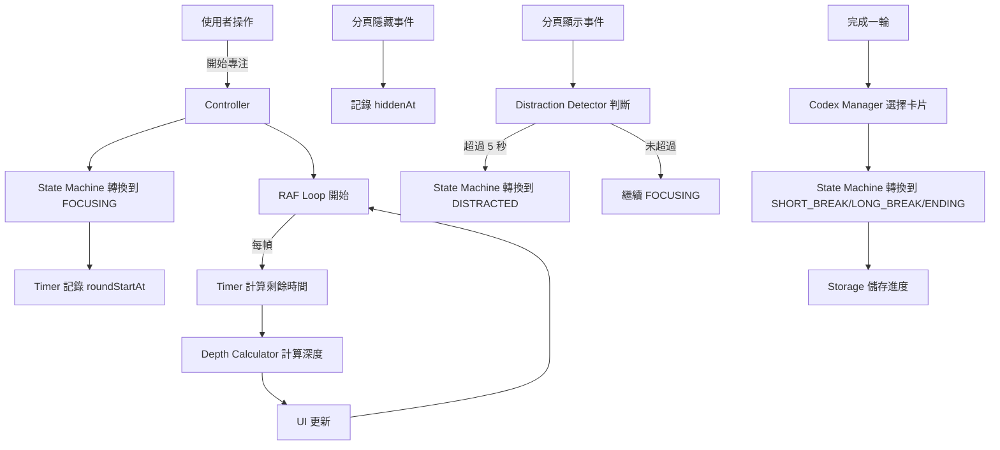

# Design Document

## Overview

focus-core 是深海番茄鐘 web app 的核心計時與狀態管理模組。本設計採用時間戳驅動的計時機制、明確的狀態機架構、以及模組化的設計,確保計時準確性、狀態可預測性、以及測試可行性。

### 設計目標

1. **時間戳驅動**：所有時間計算基於時間戳差值,不依賴 setInterval 計數,確保分頁節流或切換時計時仍準確
2. **狀態明確**：使用狀態機管理應用程式狀態,避免零散布林值帶來的複雜度
3. **模組分離**：將計時、深度計算、圖鑑管理、儲存等職責分離到獨立模組
4. **可測試性**：每個模組提供純函數介面,方便單元測試與屬性測試
5. **持久化**：使用 localStorage 保存進度,支援關閉後重開
6. **演示模式隔離**：演示模式使用獨立儲存空間且時間加速,不影響正常進度

### 技術棧

- **建置工具**：Vite
- **語言**：TypeScript (strict mode)
- **測試框架**：Vitest
- **屬性測試**：fast-check (用於適合的測試場景)
- **瀏覽器 API**：Page Visibility API、localStorage、requestAnimationFrame

## Architecture

### 模組架構

系統採用分層架構,從底層到上層依次為:

```
┌─────────────────────────────────────┐
│         UI Layer (暫時)              │
│  (顯示狀態、深度、控制按鈕)           │
└─────────────────────────────────────┘
                  ↓
┌─────────────────────────────────────┐
│      Application Controller          │
│  (協調各模組、處理事件、驅動狀態轉換) │
└─────────────────────────────────────┘
                  ↓
┌──────────┬──────────┬──────────┬────────────┐
│  State   │  Timer   │  Depth   │  Codex     │
│  Machine │          │  Calc    │  Manager   │
└──────────┴──────────┴──────────┴────────────┘
                  ↓
┌─────────────────────────────────────┐
│      Storage (localStorage)          │
└─────────────────────────────────────┘
                  ↓
┌─────────────────────────────────────┐
│      Config (集中設定)                │
└─────────────────────────────────────┘
```

### 模組職責

| 模組 | 職責 | 輸入 | 輸出 |
|---|---|---|---|
| **Config** | 集中管理所有可調整參數 | 無 | 設定常數 |
| **State Machine** | 管理應用程式狀態與轉換 | 事件、���前狀態 | 新狀態、是否允許轉換 |
| **Timer** | 計算已流逝時間與剩餘時間 | 時間戳、時長、Demo_Mode | 剩餘時間、專注時間 |
| **Depth Calculator** | 計算深度、Zone、上浮懲罰 | 專注時間、累積深度 | 深度、Zone 名稱 |
| **Distraction Detector** | 偵測分心事件與計算懲罰 | 隱藏時長、本輪深度 | 是否觸發、上浮深度 |
| **Codex Manager** | 管理卡片解鎖邏輯 | 總深度、已解鎖清單 | 新卡片、是否重複 |
| **Storage** | localStorage 讀寫與序列化 | 應用程式狀態 | 持久化資料 |
| **Demo Mode** | 提供時間加速與儲存隔離 | 是否啟用 | 時間倍率、儲存 key |
| **Application Controller** | 協調各模組、處理使用者操作 | 使用者操作、瀏覽器事件 | 驅動狀態更新 |

### 資料流



## Components and Interfaces

### 1. Config 模組

集中管理所有可調整參數。

**檔案**：`src/config.ts`

**介面**：

```typescript
export const Config = {
  // 計時參數
  descentSpeedPerMinute: 12, // 公尺/分鐘
  durationOptions: [15, 25, 45], // 分鐘
  
  // 分心參數
  distractionThreshold: 5, // 秒
  distractedDurationSec: 3, // DISTRACTED 狀態持續時間（秒）
  distractionRisePercentage: 20, // %
  maxDistractionRisePercentage: 50, // %
  
  // 休息參數
  shortBreakDuration: 5, // 分鐘
  longBreakDuration: 15, // 分鐘
  longBreakInterval: 4, // 每幾輪長休息
  
  // 深度參數
  targetDepth: 10900, // 公尺
  zones: [
    { name: 'Sunlit', min: 0, max: 200 },
    { name: 'Twilight', min: 200, max: 1000 },
    { name: 'Midnight', min: 1000, max: 4000 },
    { name: 'Abyssal', min: 4000, max: 6000 },
    { name: 'Hadal', min: 6000, max: Infinity }
  ],
  
  // 演示模式
  demoModeMultiplier: 60,
  
  // 自動儲存
  autoSaveInterval: 5, // 秒
  lastSeenUpdateInterval: 5, // 秒
} as const;

export type Zone = 'Sunlit' | 'Twilight' | 'Midnight' | 'Abyssal' | 'Hadal';
```

### 2. State Machine 模組

管理應用程式狀態與狀態轉換。

**檔案**：`src/state-machine.ts`

**狀態定義**：

```typescript
export enum AppState {
  IDLE = 'IDLE',
  FOCUSING = 'FOCUSING',
  DISTRACTED = 'DISTRACTED',
  SHORT_BREAK = 'SHORT_BREAK',
  LONG_BREAK = 'LONG_BREAK',
  ENDING = 'ENDING'
}

export type StateTransitionEvent =
  | { type: 'START_FOCUS'; durationMinutes: number }
  | { type: 'DISTRACTION_DETECTED' }
  | { type: 'DISTRACTION_ANIMATION_COMPLETE' }
  | { type: 'ROUND_COMPLETE'; shouldShowEnding: boolean; isLongBreak: boolean }
  | { type: 'BREAK_COMPLETE' }
  | { type: 'SKIP_BREAK' }
  | { type: 'ABANDON_ROUND' }
  | { type: 'ENDING_CONFIRMED' }
  | { type: 'DIVE_AGAIN' };
```

**介面**：

```typescript
export interface StateMachine {
  currentState: AppState;
  
  // 狀態轉換
  transition(event: StateTransitionEvent): TransitionResult;
  
  // 查詢
  canTransition(event: StateTransitionEvent): boolean;
  getState(): AppState;
}

export interface TransitionResult {
  success: boolean;
  newState: AppState;
  error?: string;
}
```

**狀態轉換表**：

| 當前狀態 | 事件 | 新狀態 | 條件 |
|---|---|---|---|
| IDLE | START_FOCUS | FOCUSING | 時長有效 |
| FOCUSING | DISTRACTION_DETECTED | DISTRACTED | 隱藏超過閾值 |
| DISTRACTED | DISTRACTION_ANIMATION_COMPLETE | FOCUSING | 動畫結束 |
| FOCUSING | ROUND_COMPLETE | SHORT_BREAK | 未達目標 && 非長休息輪 |
| FOCUSING | ROUND_COMPLETE | LONG_BREAK | 未達目標 && 是長休息輪 |
| FOCUSING | ROUND_COMPLETE | ENDING | 已達目標 |
| FOCUSING | ABANDON_ROUND | IDLE | - |
| DISTRACTED | ABANDON_ROUND | IDLE | - |
| SHORT_BREAK | BREAK_COMPLETE | IDLE | - |
| SHORT_BREAK | SKIP_BREAK | IDLE | - |
| LONG_BREAK | BREAK_COMPLETE | IDLE | - |
| LONG_BREAK | SKIP_BREAK | IDLE | - |
| ENDING | ENDING_CONFIRMED | IDLE | - |
| ENDING | DIVE_AGAIN | IDLE | - |
| IDLE | DIVE_AGAIN | IDLE | endingSeen 為 true |

**實作要點**：

- 使用 `switch` 語句實作轉換邏輯
- 非法轉換回傳 `{ success: false, error: '...' }`
- 狀態轉換時觸發副作用（例如通知 Storage 儲存）

### 3. Timer 模組

計算已流逝時間與剩餘時間。

**檔案**：`src/timer.ts`

**介面**：

```typescript
export interface TimerState {
  roundStartAt: number; // 時間戳 (ms)
  selectedDurationMs: number; // 選定時長 (ms)
  lastSeenAt: number; // 最後確認使用者在線的時間戳 (ms)
  hiddenAt: number | null; // 分頁隱藏時的時間戳 (ms)
  distractionPenaltyMs: number; // 本輪累積的分心懲罰時間 (ms)
  isDemoMode: boolean;
}

export interface Timer {
  // 初始化
  start(durationMinutes: number, isDemoMode: boolean): TimerState;
  
  // 計算時間
  getElapsedFocusedTime(state: TimerState, nowMs: number): number; // 已專注時間 (ms)
  getRemainingTime(state: TimerState, nowMs: number): number; // 剩餘時間 (ms)
  
  // 分心處理
  markHidden(state: TimerState, nowMs: number): TimerState;
  markVisible(state: TimerState, nowMs: number): { state: TimerState; hiddenRealMs: number; hiddenDuration: number };
  applyDistractionPenalty(state: TimerState, penaltyMs: number): TimerState;
  
  // lastSeenAt 更新
  updateLastSeen(state: TimerState, nowMs: number): TimerState;
  
  // 完成檢查
  isComplete(state: TimerState, nowMs: number): boolean;
}
```

**時間計算邏輯**：

```typescript
// 已專注時間 = (當前時間 - 開始時間) * 倍率 - 分心懲罰時間 - 當前隱藏時段
function getElapsedFocusedTime(state: TimerState, nowMs: number): number {
  const multiplier = state.isDemoMode ? Config.demoModeMultiplier : 1;
  let elapsed = (nowMs - state.roundStartAt) * multiplier;
  
  // 減去分心懲罰
  elapsed -= state.distractionPenaltyMs;
  
  // 減去當前隱藏時段（如果隱藏中）
  if (state.hiddenAt !== null) {
    elapsed -= (nowMs - state.hiddenAt) * multiplier;
  }
  
  return Math.max(0, elapsed);
}

// 剩餘時間 = 選定時長 - 已專注時間
function getRemainingTime(state: TimerState, nowMs: number): number {
  const focused = getElapsedFocusedTime(state, nowMs);
  return Math.max(0, state.selectedDurationMs - focused);
}
```

**分心處理流程**：

1. **分頁隱藏時**：`markHidden(state, nowMs)` 記錄 `hiddenAt = nowMs`
2. **分頁顯示時**：`markVisible(state, nowMs)` 計算 `hiddenRealMs = (nowMs - hiddenAt)`（真實時間）和 `hiddenDuration = hiddenRealMs * multiplier`（加速後時間）
3. **判斷是否觸發分心**：
   - 若 `hiddenRealMs > Config.distractionThreshold * 1000`：觸發分心事件（使用真實時間判斷，非加速時間）
   - 扣除的專注時間使用 `hiddenDuration`（加速後時間）
   - 若 `hiddenDuration <= Config.distractionThreshold * 1000`：不觸發，繼續專注
4. **計算懲罰**：若觸發分心，將整段隱藏時間加入 `distractionPenaltyMs`

**lastSeenAt 更新機制**：

- 在 FOCUSING 狀態時，每 5 秒呼叫 `updateLastSeen(state, nowMs)` 更新 `lastSeenAt`
- 在 `pagehide` 事件時也呼叫 `updateLastSeen(state, nowMs)`
- 關頁後重開時，使用 `lastSeenAt` 計算保留深度：`min(lastSeenAt - roundStartAt, selectedDurationMs)`

### 4. Depth Calculator 模組

計算深度、Zone、上浮懲罰。

**檔案**：`src/depth-calculator.ts`

**介面**：

```typescript
export interface DepthState {
  totalDepth: number; // 累積總深度 (m)
  roundStartDepth: number; // 本輪開始時的深度 (m)
  roundDescentDepth: number; // 本輪下沉深度 (m)
  roundRisePenalty: number; // 本輪累積上浮懲罰 (m)
}

export interface DepthCalculator {
  // 計算深度
  calculateDescent(focusedTimeMs: number): number; // 專注時間 → 下沉深度 (m)
  
  // 更新深度狀態
  updateRoundDescent(state: DepthState, focusedTimeMs: number): DepthState;
  
  // 上浮懲罰
  calculateRisePenalty(currentDescent: number, distractionCount: number): number;
  applyRisePenalty(state: DepthState, risePenalty: number): DepthState;
  
  // 完成一輪
  commitRound(state: DepthState): DepthState;
  
  // 放棄一輪
  abandonRound(state: DepthState): DepthState;
  
  // 重新下潛
  resetDepth(state: DepthState): DepthState;
  
  // Zone 查詢
  getZone(totalDepth: number): Zone;
  hasReachedTarget(totalDepth: number): boolean;
}
```

**深度計算公式**：

```typescript
// 下沉深度 = 專注時間（分鐘）× 下沉速度（公尺/分鐘）
function calculateDescent(focusedTimeMs: number): number {
  const focusedMinutes = focusedTimeMs / 1000 / 60;
  return focusedMinutes * Config.descentSpeedPerMinute;
}
```

**上浮懲罰計算**：

```typescript
// 單次上浮懲罰 = 當下本輪已下沉深度 × 20%
// 本輪累積上浮 ≤ 本輪原始下沉深度 × 50%
function calculateRisePenalty(currentDescent: number, distractionCount: number): number {
  const singlePenalty = currentDescent * (Config.distractionRisePercentage / 100);
  return singlePenalty;
}

function applyRisePenalty(state: DepthState, risePenalty: number): DepthState {
  const newRisePenalty = state.roundRisePenalty + risePenalty;
  const maxRise = state.roundDescentDepth * (Config.maxDistractionRisePercentage / 100);
  const cappedRisePenalty = Math.min(newRisePenalty, maxRise);
  
  return {
    ...state,
    roundRisePenalty: cappedRisePenalty
  };
}
```

**淨深度計算**：

```typescript
// 本輪淨下沉 = 本輪下沉深度 - 本輪上浮懲罰
// 當前總深度 = 本輪開始深度 + 本輪淨下沉
function getCurrentTotalDepth(state: DepthState): number {
  const netDescent = Math.max(0, state.roundDescentDepth - state.roundRisePenalty);
  const total = state.roundStartDepth + netDescent;
  return Math.min(total, Config.targetDepth);
}
```

**完成一輪**：

```typescript
function commitRound(state: DepthState): DepthState {
  const netDescent = Math.max(0, state.roundDescentDepth - state.roundRisePenalty);
  const newTotal = Math.min(
    state.roundStartDepth + netDescent,
    Config.targetDepth
  );
  
  return {
    totalDepth: newTotal,
    roundStartDepth: newTotal,
    roundDescentDepth: 0,
    roundRisePenalty: 0
  };
}
```

**Zone 判斷**：

```typescript
function getZone(totalDepth: number): Zone {
  for (const zone of Config.zones) {
    if (totalDepth >= zone.min && totalDepth < zone.max) {
      return zone.name;
    }
  }
  return 'Hadal'; // fallback
}
```

### 5. Distraction Detector 模組

偵測分心事件與計算懲罰。

**檔案**：`src/distraction-detector.ts`

**介面**：

```typescript
export interface DistractionEvent {
  triggered: boolean; // 是否觸發分心事件
  hiddenDuration: number; // 隱藏時長 (ms)
  shouldExcludeTime: boolean; // 是否排除此段時間
}

export interface DistractionDetector {
  // 判斷是否觸發分心
  checkDistraction(hiddenDurationMs: number): DistractionEvent;
  
  // 計算上浮懲罰
  calculateRisePenalty(currentDescentDepth: number): number;
}
```

**分心判斷邏輯**：

```typescript
function checkDistraction(hiddenDurationMs: number): DistractionEvent {
  const thresholdMs = Config.distractionThreshold * 1000;
  
  if (hiddenDurationMs > thresholdMs) {
    // 隱藏超過 5 秒：觸發分心，排除整段時間
    return {
      triggered: true,
      hiddenDuration: hiddenDurationMs,
      shouldExcludeTime: true
    };
  } else {
    // 隱藏未超過 5 秒：不觸發分心，時間計入專注
    return {
      triggered: false,
      hiddenDuration: hiddenDurationMs,
      shouldExcludeTime: false
    };
  }
}
```

**懲罰計算**：

```typescript
function calculateRisePenalty(currentDescentDepth: number): number {
  return currentDescentDepth * (Config.distractionRisePercentage / 100);
}
```

**Page Visibility API 整合**：

```typescript
// 在 Application Controller 中
document.addEventListener('visibilitychange', () => {
  if (document.hidden) {
    // 分頁隱藏：記錄 hiddenAt
    if (stateMachine.getState() === AppState.FOCUSING) {
      timerState = timer.markHidden(timerState, Date.now());
      storage.save(); // 立即儲存
    }
  } else {
    // 分頁顯示：判斷是否觸發分心
    if (stateMachine.getState() === AppState.FOCUSING) {
      const { state: newTimerState, hiddenRealMs, hiddenDuration } = timer.markVisible(
        timerState,
        Date.now()
      );
      timerState = newTimerState;
      
      const event = distractionDetector.checkDistraction(hiddenDuration);
      
      if (event.triggered) {
        // 觸發分心：轉換狀態
        stateMachine.transition({ type: 'DISTRACTION_DETECTED' });
        distractedStartAt = Date.now(); // 記錄 DISTRACTED 開始時間
        
        // 計算上浮懲罰
        const penalty = distractionDetector.calculateRisePenalty(
          depthState.roundDescentDepth
        );
        depthState = depthCalculator.applyRisePenalty(depthState, penalty);
        
        // 將隱藏時間加入懲罰
        timerState = timer.applyDistractionPenalty(timerState, hiddenDuration);
      }
      // 若未觸發，時間自動計入專注（不需額外處理）
    }
  }
});

// pagehide 事件：更新 lastSeenAt
window.addEventListener('pagehide', () => {
  if (stateMachine.getState() === AppState.FOCUSING) {
    timerState = timer.updateLastSeen(timerState, Date.now());
    storage.save();
  }
});
```

### 6. Codex Manager 模組

管理卡片解鎖邏輯。

**檔案**：`src/codex-manager.ts`

**資料結構**：

```typescript
export interface CreatureCard {
  id: string;
  zone: Zone;
  scientificName: string;
  commonNameEn: string;
  commonNameZh: string;
  depthRange: string;
  facts: string;
  isEndingCard: boolean; // Supergiant amphipod 特殊標記
}

export interface UnlockedCard {
  cardId: string;
  unlockedAt: number; // 時間戳
  obtainedCount: number; // 獲得次數
}

export interface CodexState {
  unlockedCards: UnlockedCard[];
}

export interface UnlockResult {
  card: CreatureCard;
  isDuplicate: boolean;
}
```

**6 張卡片定義**：

```typescript
export const CREATURE_CARDS: CreatureCard[] = [
  {
    id: 'moon-jellyfish',
    zone: 'Sunlit',
    scientificName: 'Aurelia aurita',
    commonNameEn: 'Moon jellyfish',
    commonNameZh: '海月水母',
    depthRange: '0-1,250 m',
    facts: 'Mostly near the surface in coastal waters; recorded 0–1,250 m. Sources: SeaLifeBase; WoRMS',
    isEndingCard: false
  },
  {
    id: 'barreleye',
    zone: 'Twilight',
    scientificName: 'Macropinna microstoma',
    commonNameEn: 'Barreleye',
    commonNameZh: '桶眼魚',
    depthRange: '600-800 m',
    facts: '600–800 m; transparent head, green tubular eyes. Sources: MBARI; Monterey Bay Aquarium',
    isEndingCard: false
  },
  {
    id: 'humpback-anglerfish',
    zone: 'Midnight',
    scientificName: 'Melanocetus johnsonii',
    commonNameEn: 'Humpback anglerfish',
    commonNameZh: '黑魔鬼鮟鱇',
    depthRange: '100-3,600 m',
    facts: 'Usually 100–1,500 m (most often 500–1,500 m); recorded to ~3,600 m. Sources: FishBase; Pietsch via Zenodo',
    isEndingCard: false
  },
  {
    id: 'dumbo-octopus',
    zone: 'Abyssal',
    scientificName: 'Grimpoteuthis spp.',
    commonNameEn: 'Dumbo octopus',
    commonNameZh: '小飛象章魚',
    depthRange: '1,000-7,000 m',
    facts: '1,000–7,000 m; deepest octopus ever filmed at 6,957 m (Java Trench, 2020). Sources: NHM London; Marine Biology 2020; Guinness',
    isEndingCard: false
  },
  {
    id: 'mariana-snailfish',
    zone: 'Hadal',
    scientificName: 'Pseudoliparis swirei',
    commonNameEn: 'Mariana snailfish',
    commonNameZh: '馬里亞納獅子魚',
    depthRange: '6,198-8,178 m',
    facts: '6,198–8,178 m, usually 7,000–8,000 m; no fish likely below ~8,400 m. Sources: FishBase; NOAA Ocean Exploration',
    isEndingCard: false
  },
  {
    id: 'supergiant-amphipod',
    zone: 'Hadal',
    scientificName: 'Hirondellea gigas',
    commonNameEn: 'Supergiant amphipod',
    commonNameZh: '巨型端足類',
    depthRange: '6,800-11,000 m',
    facts: '~6,800–11,000 m; dominant animal of Challenger Deep (collected at 10,929 m). Sources: Cell 2025; Mitochondrial DNA B 2016',
    isEndingCard: true
  }
];
```

**介面**：

```typescript
export interface CodexManager {
  // 選擇卡片
  selectCardForRound(
    totalDepth: number,
    codexState: CodexState,
    shouldShowEnding: boolean
  ): UnlockResult;
  
  // 查詢
  isUnlocked(cardId: string, codexState: CodexState): boolean;
  getUnlockedCards(codexState: CodexState): CreatureCard[];
  getCard(cardId: string): CreatureCard | undefined;
}
```

**選擇卡片邏輯**：

```typescript
function selectCardForRound(
  totalDepth: number,
  codexState: CodexState,
  isEnding: boolean
): UnlockResult {
  // 特殊情況：進入 ENDING 狀態
  if (shouldShowEnding) {
    const endingCard = CREATURE_CARDS.find(c => c.isEndingCard)!;
    return unlockCard(endingCard, codexState);
  }
  
  // 一般情況：從前 5 張卡片中選擇
  const normalCards = CREATURE_CARDS.filter(c => !c.isEndingCard);
  
  // 1. 找出所有尚未解鎖的卡片
  const unlockedIds = new Set(codexState.unlockedCards.map(u => u.cardId));
  const lockedCards = normalCards.filter(c => !unlockedIds.has(c.id));
  
  // 2. 找出所有已達深度的卡片
  const reachableCards = lockedCards.filter(c => {
    const cardZone = Config.zones.find(z => z.name === c.zone)!;
    return totalDepth >= cardZone.min;
  });
  
  // 3. 選擇最淺的卡片
  if (reachableCards.length > 0) {
    const shallowestCard = reachableCards.reduce((prev, curr) => {
      const prevZone = Config.zones.find(z => z.name === prev.zone)!;
      const currZone = Config.zones.find(z => z.name === curr.zone)!;
      return prevZone.min < currZone.min ? prev : curr;
    });
    return unlockCard(shallowestCard, codexState);
  }
  
  // 4. 所有已達 Zone 的卡片都已解鎖 → 重複記錄
  // 選擇已解鎖中最深的卡片（代表當前所在海域）
  const unlockedReachableCards = normalCards.filter(c => {
    const cardZone = Config.zones.find(z => z.name === c.zone)!;
    return totalDepth >= cardZone.min && unlockedIds.has(c.id);
  });
  
  if (unlockedReachableCards.length > 0) {
    const deepestUnlocked = unlockedReachableCards.reduce((prev, curr) => {
      const prevZone = Config.zones.find(z => z.name === prev.zone)!;
      const currZone = Config.zones.find(z => z.name === curr.zone)!;
      return prevZone.min > currZone.min ? prev : curr; // 改為選擇最深的
    });
    return markDuplicate(deepestUnlocked, codexState);
  }
  
  // 理論上不會到這裡（第一輪一定可以拿到 Moon jellyfish）
  throw new Error('No card available');
}

function unlockCard(card: CreatureCard, codexState: CodexState): UnlockResult {
  // 新增到 unlockedCards
  codexState.unlockedCards.push({
    cardId: card.id,
    unlockedAt: Date.now(),
    obtainedCount: 1
  });
  
  return { card, isDuplicate: false };
}

function markDuplicate(card: CreatureCard, codexState: CodexState): UnlockResult {
  // 增加 obtainedCount
  const unlocked = codexState.unlockedCards.find(u => u.cardId === card.id)!;
  unlocked.obtainedCount += 1;
  
  return { card, isDuplicate: true };
}
```

### 7. Storage 模組

localStorage 讀寫與序列化。

**檔案**：`src/storage.ts`

**資料結構**：

```typescript
export interface StoredData {
  version: number; // 資料版本（未來遷移用）
  totalDepth: number;
  completedRounds: number;
  endingSeen: boolean; // 是否已經看過 ENDING 狀態
  codex: CodexState;
  settings: UserSettings;
  currentState: {
    state: AppState;
    roundStartAt: number | null;
    lastSeenAt: number | null;
    hiddenAt: number | null;
    selectedDurationMs: number | null;
    distractionPenaltyMs: number;
    roundStartDepth: number;
    roundDescentDepth: number;
    roundRisePenalty: number;
  };
}

export interface UserSettings {
  // 使用者設定（例如音效、語言等，目前暫無）
}
```

**介面**：

```typescript
export interface Storage {
  // 儲存與載入
  save(data: StoredData, isDemoMode: boolean): void;
  load(isDemoMode: boolean): StoredData | null;
  
  // 清除
  clear(isDemoMode: boolean): void;
  clearAll(): void; // 清除正常與演示模式
}
```

**實作**：

```typescript
const STORAGE_KEY = 'deep-sea-focus';
const DEMO_STORAGE_KEY = 'demo_deep-sea-focus';
const CURRENT_VERSION = 1;

function save(data: StoredData, isDemoMode: boolean): void {
  const key = isDemoMode ? DEMO_STORAGE_KEY : STORAGE_KEY;
  try {
    const json = JSON.stringify(data);
    localStorage.setItem(key, json);
  } catch (error) {
    console.error('Failed to save to localStorage:', error);
  }
}

function load(isDemoMode: boolean): StoredData | null {
  const key = isDemoMode ? DEMO_STORAGE_KEY : STORAGE_KEY;
  try {
    const json = localStorage.getItem(key);
    if (!json) return null;
    
    const data = JSON.parse(json) as StoredData;
    
    // 版本檢查與遷移
    if (data.version !== CURRENT_VERSION) {
      console.warn('Data version mismatch, attempting migration...');
      return migrateData(data);
    }
    
    return data;
  } catch (error) {
    console.error('Failed to load from localStorage:', error);
    return null;
  }
}

function migrateData(data: any): StoredData | null {
  // 未來資料格式變更時的遷移邏輯
  // 目前回傳 null 表示無法遷移，使用預設值
  return null;
}
```

**重開復原邏輯**：

```typescript
// 在 Application Controller 初始化時
function restoreFromStorage(storage: Storage, isDemoMode: boolean): void {
  const data = storage.load(isDemoMode);
  if (!data) return;
  
  // 復原深度與圖鑑
  depthState.totalDepth = data.totalDepth;
  completedRounds = data.completedRounds;
  endingSeen = data.endingSeen;
  codexState = data.codex;
  
  // 處理未完成狀態
  if (data.currentState.state === AppState.FOCUSING || 
      data.currentState.state === AppState.DISTRACTED) {
    // 視為放棄：使用 getElapsedFocusedTime 計算保留深度
    
    // 先載入本輪的起始深度和上浮懲罰
    depthState.roundStartDepth = data.currentState.roundStartDepth;
    depthState.roundRisePenalty = data.currentState.roundRisePenalty;
    
    const timerState: TimerState = {
      roundStartAt: data.currentState.roundStartAt!,
      selectedDurationMs: data.currentState.selectedDurationMs!,
      lastSeenAt: data.currentState.lastSeenAt || data.currentState.roundStartAt!,
      hiddenAt: data.currentState.hiddenAt,
      distractionPenaltyMs: data.currentState.distractionPenaltyMs,
      isDemoMode: isDemoMode
    };
    
    const lastSeenAt = timerState.lastSeenAt;
    const focusedTime = timer.getElapsedFocusedTime(timerState, lastSeenAt);
    const cappedTime = Math.min(focusedTime, timerState.selectedDurationMs);
    const descent = depthCalculator.calculateDescent(cappedTime);
    
    depthState.roundDescentDepth = descent;
    depthState = depthCalculator.abandonRound(depthState);
    
    // 直接設定狀態為 IDLE（不走 transition）
    stateMachine.currentState = AppState.IDLE;
  } else if (
    data.currentState.state === AppState.SHORT_BREAK ||
    data.currentState.state === AppState.LONG_BREAK
  ) {
    // 視為休息完成
    stateMachine.currentState = AppState.IDLE;
  }
  // IDLE、ENDING 保持原狀
}
```

### 8. Demo Mode 模組

提供時間加速與儲存隔離。

**檔案**：`src/demo-mode.ts`

**介面**：

```typescript
export interface DemoMode {
  isEnabled: boolean;
  
  // 切換
  toggle(): boolean; // 回傳新狀態
  canToggle(currentState: AppState): boolean;
  
  // 查詢
  getTimeMultiplier(): number;
  getStorageKey(): string;
}
```

**實作**：

```typescript
class DemoModeImpl implements DemoMode {
  private enabled = false;
  
  toggle(): boolean {
    this.enabled = !this.enabled;
    return this.enabled;
  }
  
  canToggle(currentState: AppState): boolean {
    return currentState === AppState.IDLE;
  }
  
  getTimeMultiplier(): number {
    return this.enabled ? Config.demoModeMultiplier : 1;
  }
  
  getStorageKey(): string {
    return this.enabled ? 'demo_' : '';
  }
}
```

**切換時重新載入資料**：

```typescript
// 在 UI 中
function onDemoModeToggle(): void {
  if (!demoMode.canToggle(stateMachine.getState())) {
    // 不使用 alert，改為在 UI 中停用按鈕
    return;
  }
  
  // 儲存當前模式資料
  storage.save(getCurrentData(), demoMode.isEnabled);
  
  // 切換
  const newState = demoMode.toggle();
  
  // 載入新模式資料
  restoreFromStorage(storage, newState);
}
```

### 9. Application Controller

協調各模組、處理使用者操作與瀏覽器事件。

**檔案**：`src/app-controller.ts`

**職責**：

1. 初始化各模組
2. 處理使用者操作（開始專注、放棄、跳過休息等）
3. 處理瀏覽器事件（visibilitychange、pagehide）
4. 驅動 RAF loop 更新 UI
5. 定期自動儲存


**全域變數**：

```typescript
let distractedStartAt: number = 0; // DISTRACTED 狀態開始時間
```

**RAF Loop**：

```typescript
function rafLoop(): void {
  const nowMs = Date.now();
  const state = stateMachine.getState();
  
  if (state === AppState.FOCUSING) {
    // 更新計時與深度
    const focusedTime = timer.getElapsedFocusedTime(timerState, nowMs);
    const remaining = timer.getRemainingTime(timerState, nowMs);
    
    depthState = depthCalculator.updateRoundDescent(depthState, focusedTime);
    
    // 檢查是否完成
    if (timer.isComplete(timerState, nowMs)) {
      handleRoundComplete();
    }
    
    // 更新 UI
    updateUI();
    
    // 定期更新 lastSeenAt（每 5 秒）
    if (nowMs - lastSaveTime > Config.autoSaveInterval * 1000) {
      timerState = timer.updateLastSeen(timerState, nowMs);
      storage.save(getCurrentData(), demoMode.isEnabled);
      lastSaveTime = nowMs;
    }
  } else if (state === AppState.DISTRACTED) {
    // DISTRACTED 狀態自動結束
    const distractedDuration = nowMs - distractedStartAt;
    if (distractedDuration >= Config.distractedDurationSec * 1000) {
      stateMachine.transition({ type: 'DISTRACTION_ANIMATION_COMPLETE' });
    }
    
    // 期間不檢查完成
    updateUI();
  } else if (state === AppState.SHORT_BREAK || state === AppState.LONG_BREAK) {
    // 休息倒數
    // ... 類似邏輯
  }
  
  requestAnimationFrame(rafLoop);
}
```

**處理完成一輪**：

```typescript
function handleRoundComplete(): void {
  // 1. 先完成深度計算（commitRound）
  depthState = depthCalculator.commitRound(depthState);
  
  // 2. 再用 commit 後的深度判斷是否達目標
  const reachedTarget = depthCalculator.hasReachedTarget(depthState.totalDepth);
  
  // 3. 判斷是否應該進入 ENDING（第一次到底）
  const shouldShowEnding = reachedTarget && !endingSeen;
  
  // 4. 計算是否長休息（只有非 ENDING 時才判斷）
  const isLongBreak = !shouldShowEnding && 
                      (completedRounds + 1) % Config.longBreakInterval === 0;
  
  // 5. 選擇卡片
  const unlockResult = codexManager.selectCardForRound(
    depthState.totalDepth,
    codexState,
    shouldShowEnding
  );
  
  // 6. 增加完成輪數
  completedRounds += 1;
  
  // 7. 如果進入 ENDING，設定 endingSeen
  if (shouldShowEnding) {
    endingSeen = true;
  }
  
  // 8. 顯示卡片（UI 邏輯）
  showCardReveal(unlockResult);
  
  // 9. 轉換狀態
  stateMachine.transition({
    type: 'ROUND_COMPLETE',
    shouldShowEnding,
    isLongBreak: !shouldShowEnding && isLongBreak
  });
  
  // 10. 儲存
  storage.save(getCurrentData(), demoMode.isEnabled);
}
```

## Data Models

### 應用程式全域狀態

```typescript
export interface AppGlobalState {
  // 狀態機
  stateMachine: StateMachine;
  
  // 計時器
  timerState: TimerState;
  
  // 深度
  depthState: DepthState;
  
  // 圖鑑
  codexState: CodexState;
  
  // 完成輪數
  completedRounds: number;
  
  // 演示模式
  demoMode: DemoMode;
  
  // 使用者設定
  settings: UserSettings;
}
```

### localStorage 資料格式

```json
{
  "version": 1,
  "totalDepth": 1234.5,
  "completedRounds": 3,
  "codex": {
    "unlockedCards": [
      {
        "cardId": "moon-jellyfish",
        "unlockedAt": 1732000000000,
        "obtainedCount": 2
      }
    ]
  },
  "settings": {},
  "currentState": {
    "state": "IDLE",
    "roundStartAt": null,
    "lastSeenAt": null,
    "hiddenAt": null,
    "selectedDurationMs": null,
    "distractionPenaltyMs": 0,
    "roundStartDepth": 1234.5,
    "roundDescentDepth": 0,
    "roundRisePenalty": 0
  }
}
```

## Correctness Properties

*A property is a characteristic or behavior that should hold true across all valid executions of a system—essentially, a formal statement about what the system should do. Properties serve as the bridge between human-readable specifications and machine-verifiable correctness guarantees.*

### Property 1: 時間戳計算穩定性

*For any* timer state and two timestamps `t1` and `t2` where `t1 < t2`, the elapsed focused time calculated at `t2` SHALL be greater than or equal to the elapsed focused time calculated at `t1` (unless distraction penalty is applied between them).

**Validates: Requirements 4.2, 4.4**

### Property 2: 深度單調性

*For any* depth state, completing or abandoning a round SHALL never decrease the total depth below its value at the start of that round.

**Validates: Requirements 5.4, 9.2**

### Property 3: Zone 判斷一致性

*For any* depth value, calling `getZone(depth)` multiple times SHALL always return the same zone name.

**Validates: Requirements 5.6**

### Property 4: 狀態轉換合法性

*For any* state machine in state S and event E, if `canTransition(E)` returns false, then `transition(E)` SHALL return `{ success: false }` and the state SHALL remain S.

**Validates: Requirements 3.12**

### Property 5: 上浮懲罰上限

*For any* round, the cumulative rise penalty SHALL never exceed 50% of the round's original descent depth.

**Validates: Requirements 6.9**

### Property 6: 分心閾值判斷

*For any* hidden duration, if `hiddenDuration <= 5000ms`, then `checkDistraction()` SHALL return `{ triggered: false, shouldExcludeTime: false }`, and the hidden time SHALL be counted as focused time.

**Validates: Requirements 6.5, 6.7**

### Property 7: 卡片選擇最淺優先

*For any* total depth and codex state with at least one unlocked card remaining, the selected card SHALL have a zone with minimum depth less than or equal to all other unlocked cards' zones.

**Validates: Requirements 8.3**

### Property 8: 卡片深度限制

*For any* total depth and selected card (excluding ending card), the card's zone minimum depth SHALL be less than or equal to the total depth.

**Validates: Requirements 8.4**

### Property 9: 終局卡專屬性

*For any* round completion, the Supergiant amphipod card SHALL only be selected when `isEnding` is true (i.e., total depth has reached 10,900m and the round completes).

**Validates: Requirements 8.9, 8.10**

### Property 10: 儲存載入往返

*For any* valid application state, saving it to storage and then loading it back SHALL produce an equivalent state.

**Validates: Requirements 14.6**

### Property 11: Demo 模式隔離

*For any* progress made in demo mode, switching back to normal mode SHALL show the progress saved before demo mode was enabled, unaffected by demo mode changes.

**Validates: Requirements 11.8**

### Property 12: 重新下潛保留

*For any* codex state and completed rounds count before "dive again", after resetting depth to 0, the codex and completed rounds SHALL remain unchanged.

**Validates: Requirements 9.14, 9.15**

### Property 13: lastSeenAt 深度上限

*For any* application restart after closing during FOCUSING, the preserved depth SHALL never exceed the depth calculated from the selected duration (even if `lastSeenAt` suggests more time).

**Validates: Requirements 9.6**

### Property 14: 長休息輪次

*For any* completed rounds count, if `(completedRounds + 1) % 4 === 0`, then the next break SHALL be LONG_BREAK; otherwise SHORT_BREAK (unless reaching target).

**Validates: Requirements 7.5, 9.8**

### Property 15: 專注時間非負

*For any* timer state and timestamp, the calculated elapsed focused time SHALL always be greater than or equal to 0.

**Validates: Requirements 4.2**

## Error Handling

### 錯誤類型與處理策略

| 錯誤類型 | 偵測位置 | 處理策略 |
|---|---|---|
| localStorage 讀取失敗 | Storage.load() | 記錄 console.error，回傳 null，使用預設值 |
| localStorage 寫入失敗 | Storage.save() | 記錄 console.error，不中斷應用 |
| localStorage 資料格式無效 | Storage.load() | 記錄 console.warn，嘗試遷移或回傳 null |
| 非法狀態轉換 | StateMachine.transition() | 回傳 `{ success: false, error: '...' }` |
| 卡片選擇失敗 | CodexManager.selectCardForRound() | 拋出錯誤（理論上不會發生） |
| 時間計算異常 | Timer | 使用 Math.max(0, ...) 確保非負 |
| 深度計算異常 | DepthCalculator | 使用 Math.min(..., targetDepth) 確保上限 |

### 邊界條件

1. **深度 = 0**：應用程式初始狀態，所有計算正常
2. **深度 = 10,900m**：達到目標深度，限制不再增長
3. **專注時間 = 0**：放棄或立即完成，深度計算為 0
4. **隱藏時長 = 5 秒**：邊界值，判斷為「未超過」，不觸發分心
5. **完成輪數 = 0**：第一輪，判斷為非長休息
6. **所有卡片已解鎖**：記錄重複，不拋出錯誤

### 重開恢復邊界情況

- **lastSeenAt 為 null**：使用 roundStartAt 作為 fallback
- **selectedDurationMs 為 null**：視為無效狀態，重置為 IDLE
- **深度計算超出時長**：使用 `min(focusedTime, selectedDuration)` 限制

## Testing Strategy

### 單元測試覆蓋

採用雙重測試策略：單元測試驗證具體範例與邊界條件，屬性測試驗證普遍性質。

#### 1. Config 模組

**單元測試**：
- 驗證所有預設值是否正確設定
- 驗證 zones 定義是否涵蓋所有深度範圍

#### 2. State Machine 模組

**單元測試**：
- 測試每個合法狀態轉換
- 測試每個非法狀態轉換回傳 false
- 測試邊界情況（例如 IDLE → IDLE）

**屬性測試**：
- **Property**: *For any* invalid state transition, `canTransition()` and `transition()` results should be consistent (Feature: focus-core, Property 4)

#### 3. Timer 模組

**單元測試**：
- 測試時間戳計算準確性
- 測試 Demo 模式時間加速（60 倍）
- 測試分心懲罰扣除
- 測試 lastSeenAt 更新
- 測試隱藏時段時間排除
- 測試邊界情況（nowMs < roundStartAt，結果為 0）

**屬性測試**：
- **Property**: *For any* timer state and two timestamps t1 < t2 (without distraction penalty between them), elapsed time at t2 >= elapsed time at t1 (Feature: focus-core, Property 1)
- **Property**: *For any* timer state, elapsed focused time should always be >= 0 (Feature: focus-core, Property 15)

#### 4. Depth Calculator 模組

**單元測試**：
- 測試深度計算公式（12 m/min）
- 測試上浮懲罰計算（20% 單次，50% 上限）
- 測試深度下限保護（不低於本輪開始深度）
- 測試 Zone 判斷
- 測試達到 10,900m 時限制
- 測試邊界情況（深度 = 0, 10,900m）

**屬性測試**：
- **Property**: *For any* depth state, completing or abandoning a round should never decrease total depth below round start depth (Feature: focus-core, Property 2)
- **Property**: *For any* depth value, getZone() should always return the same result (Feature: focus-core, Property 3)
- **Property**: *For any* round, cumulative rise penalty should never exceed 50% of original descent (Feature: focus-core, Property 5)

#### 5. Distraction Detector 模組

**單元測試**：
- 測試 5 秒閾值判斷（4999ms 不觸發，5001ms 觸發）
- 測試上浮懲罰計算（20%）
- 測試邊界情況（0ms、5000ms）

**屬性測試**：
- **Property**: *For any* hidden duration <= 5000ms, checkDistraction() should return triggered: false and shouldExcludeTime: false (Feature: focus-core, Property 6)

#### 6. Codex Manager 模組

**單元測試**：
- 測試第一輪獲得 Moon jellyfish
- 測試最淺優先選擇（新卡片）、最深優先選擇（重複卡片）
- 測試深度未達時不發卡
- 測試所有已達 Zone 已解鎖時記錄重複
- 測試 Supergiant amphipod 只在 ENDING 時解鎖
- 測試邊界情況（深度 = 0, 10,900m）

**屬性測試**：
- **Property**: *For any* total depth and codex state with unlocked cards remaining, selected card zone min <= all other unlocked cards' zone mins (Feature: focus-core, Property 7)
- **Property**: *For any* total depth and selected card (excluding ending), card zone min <= total depth (Feature: focus-core, Property 8)
- **Property**: *For any* round completion, Supergiant amphipod should only be selected when isEnding is true (Feature: focus-core, Property 9)

#### 7. Storage 模組

**單元測試**：
- 測試儲存與載入
- 測試清除資料
- 測試 Demo 模式隔離（不同 key）
- 測試資料格式無效時回傳 null
- 測試 JSON 序列化與反序列化

**屬性測試**：
- **Property**: *For any* valid application state, save then load should produce equivalent state (Feature: focus-core, Property 10)

#### 8. Demo Mode 模組

**單元測試**：
- 測試切換只在 IDLE 狀態允許
- 測試時間倍率（1 或 60）
- 測試儲存 key 前綴

**屬性測試**：
- **Property**: *For any* progress in demo mode, switching back to normal mode should restore pre-demo progress (Feature: focus-core, Property 11)

#### 9. 整合測試場景

**單元測試**：
- 測試完整一輪流程（開始 → 完成 → 獲得卡片 → 休息）
- 測試分心流程（開始 → 隱藏 → 顯示 → 分心動畫 → 繼續）
- 測試放棄流程（開始 → 放棄 → 深度保留）
- 測試關頁重開（FOCUSING → 關閉 → 重開 → IDLE，深度保留）
- 測試達到 10,900m（完成 → ENDING → dive again）
- 測試長休息輪次（完成第 4、8、12 輪）

**屬性測試**：
- **Property**: *For any* codex state and completed rounds before dive again, after reset the codex and rounds should remain unchanged (Feature: focus-core, Property 12)
- **Property**: *For any* restart after closing during FOCUSING, preserved depth should never exceed depth from selected duration (Feature: focus-core, Property 13)
- **Property**: *For any* completed rounds count, (count + 1) % 4 === 0 should result in LONG_BREAK (Feature: focus-core, Property 14)

### 屬性測試使用 fast-check

使用 fast-check 進行屬性測試，最少 100 次迭代。

**範例**：

```typescript
import fc from 'fast-check';
import { Timer } from './timer';

describe('Timer properties', () => {
  it('Property 1: elapsed time monotonically increases', () => {
    fc.assert(
      fc.property(
        fc.integer({ min: 0, max: 3600000 }), // roundStartAt
        fc.integer({ min: 1, max: 3600000 }), // duration
        fc.integer({ min: 0, max: 1000 }), // t1 offset
        fc.integer({ min: 0, max: 1000 }), // t2 offset
        (start, duration, offset1, offset2) => {
          const t1 = start + offset1;
          const t2 = start + Math.max(offset1, offset2);
          
          const state: TimerState = {
            roundStartAt: start,
            selectedDurationMs: duration,
            lastSeenAt: start,
            hiddenAt: null,
            distractionPenaltyMs: 0,
            isDemoMode: false
          };
          
          const timer = new Timer();
          const elapsed1 = timer.getElapsedFocusedTime(state, t1);
          const elapsed2 = timer.getElapsedFocusedTime(state, t2);
          
          // Feature: focus-core, Property 1
          expect(elapsed2).toBeGreaterThanOrEqual(elapsed1);
        }
      ),
      { numRuns: 100 }
    );
  });
});
```

### 測試覆蓋率目標

- **核心邏輯模組**（State Machine、Timer、Depth Calculator、Codex Manager）：至少 90%
- **Storage 與 Demo Mode**：至少 80%
- **整體專案**：至少 80%

### 手動測試

由於分心事件依賴瀏覽器行為，需進行手動測試：

1. **分心偵測**：
   - 開始專注後切換分頁 10 秒，回來應觸發分心動畫
   - 開始專注後切換分頁 3 秒，回來應不觸發分心
   - 測試「測試分心」按鈕手動觸發

2. **關頁重開**：
   - 專注中關閉頁面，重開應保留深度
   - 休息中關閉頁面，重開應視為休息完成

3. **長時間運行**：
   - 開啟演示模式，完整跑完一輪確認計時準確

4. **localStorage 清除**：
   - 手動清除 localStorage，重開應使用預設值

